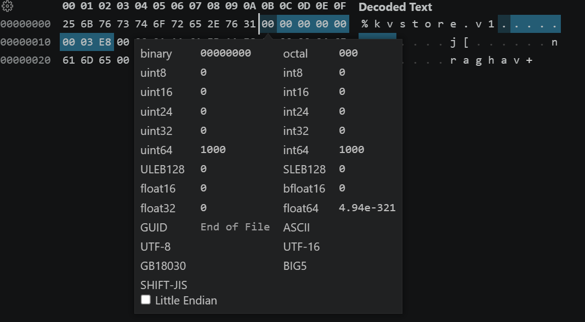
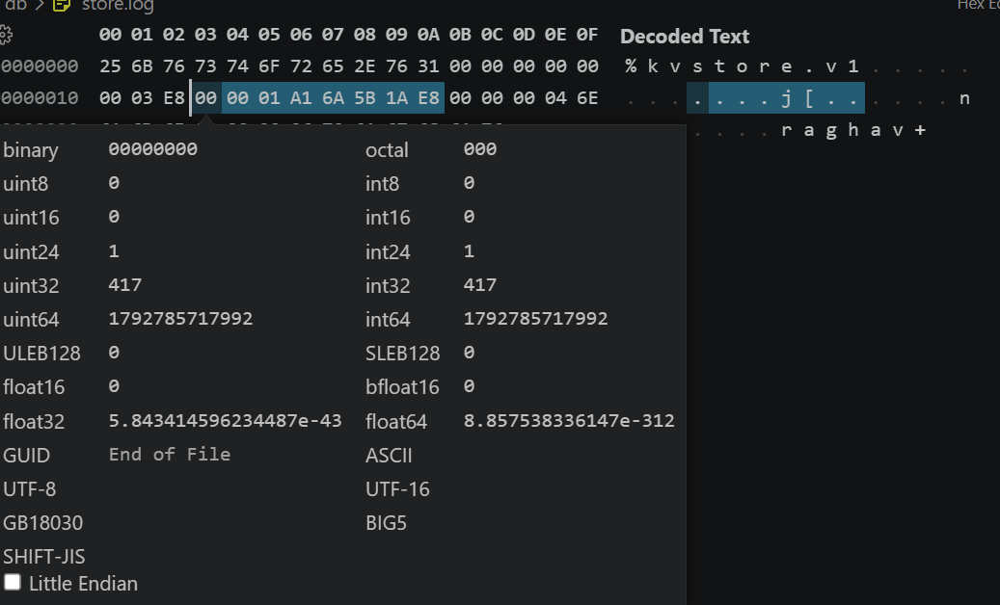
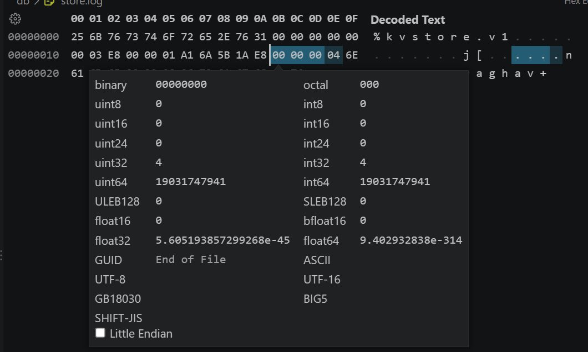
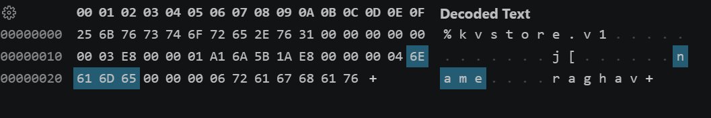
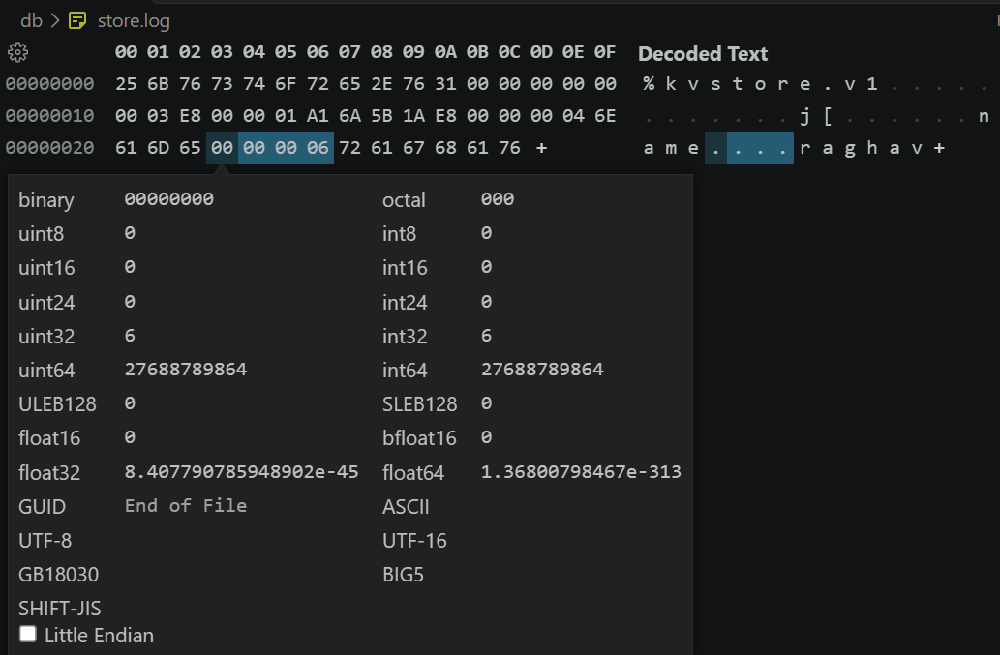
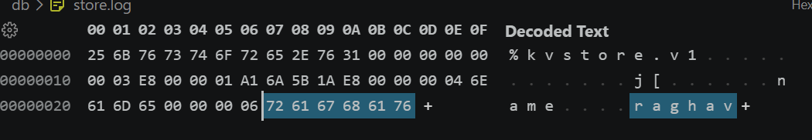

v1 Goal: Implement the most basic functionality of a key-value store inspired from Bitcask.

Features in scope:
- Basic key-value storage with put and get operations.
- Operations get durably stored by sequentially writing in a log file.
- Basic in-memory index for fast lookups.

Features not in scope:
- Advanced features like compaction and merging.
- Concurrency control and multi-threading.

## KVStore spec:

`db/store.log` is a binary append-only file. The byte-order is chosen is big-endian on account of Java's default endianness order for `ByteBuffer`s.

File layout:

| Section | Size | Description |
|---|---|---|
| File header | 11 bytes | `%kvstore.v1` |
| Records | Variable | Consecutive records appended after the header |

Record layout (fields stored in order, with no padding):

| Field | Offset within record | Size |
|---|---|---|
| CRC | 0 | 8 bytes |
| Timestamp | 8 | 8 bytes |
| Key length | 16 | 4 bytes |
| Key | 20 | K bytes |
| Value length | 20 + K | 4 bytes |
| Value | 24 + K | V bytes |

Record size: `24 + K + V` bytes.

### Example run: `name:raghav` (offsets below are relative to its start):

The first record starts at file offset 11, immediately after the header.

| Field | Offset(from 11th byte of header) | File offsets | Field + decoded value | Value stored in hex format | Hex-editor screenshot |
|---|---|---|---|---|---|
| CRC | 0–7 | 11–18 | `1000` (placeholder) | `00 00 00 00 00 00 03 E8` |  |
| Timestamp | 8–15 | 19–26 | `1792785717992` epoch milliseconds | `00 00 01 A1 6A 5B 1A E8` |  |
| Key length | 16–19 | 27–30 | `4` | `00 00 00 04` |  |
| Key | 20–23 | 31–34 | `name` | `6E 61 6D 65` |  |
| Value length | 24–27 | 35–38 | `6` | `00 00 00 06` |  |
| Value | 28–33 | 39–44 | `raghav` | `72 61 67 68 61 76` |  |

Total record size = 8 + 8 + 4 + 4 + 4 + 6 = 34 bytes.

Attached screenshots show the actual byte-level values for the run `name:raghav` in the hex-editor. The bytes highlighted in the screenshots correspond to the fields in the table above. Byte-ordering is big-endian.

## Features implemented:
- Basic read and write operations(**testing in progress**)
- Basic in-memory index for fast lookups
- `db/store.log` spec'ed format implemented

## Features to implement:
- Fault tolerance and recovery(**keydir rebuild from hint file and crc implementation**)
- Unit tests covering entirety of v1 plus actual data-heavy testing where
buffer size is not enough to hold entire record in one go
